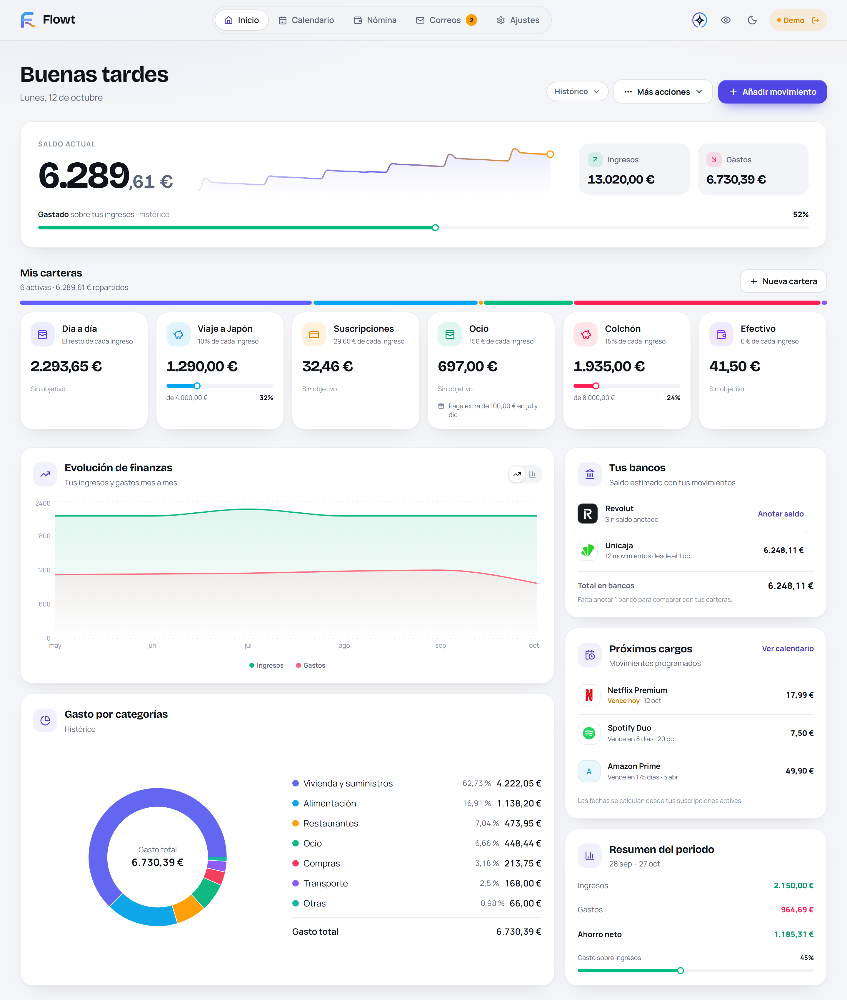
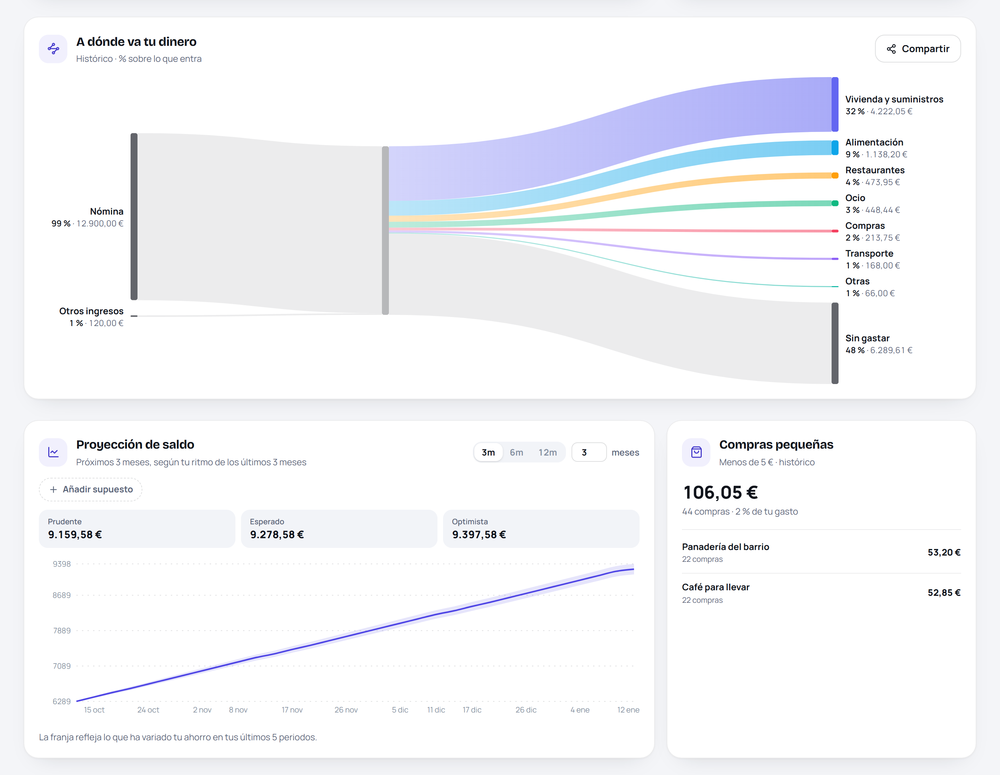
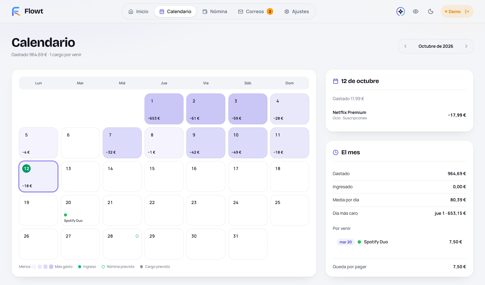
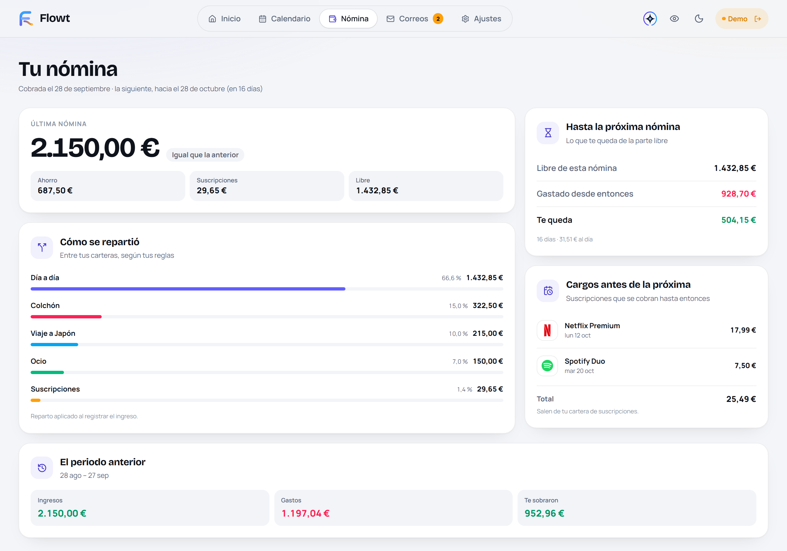
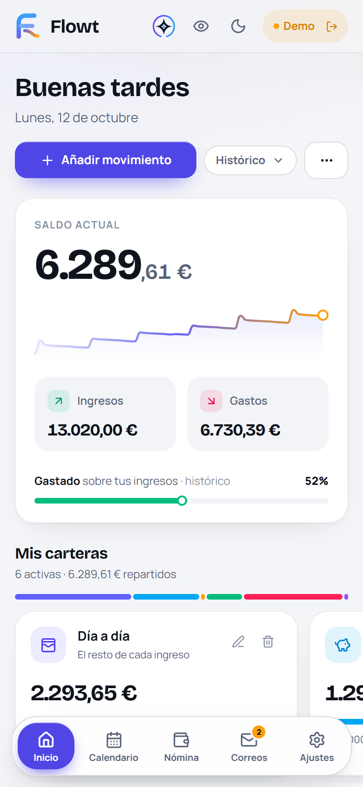
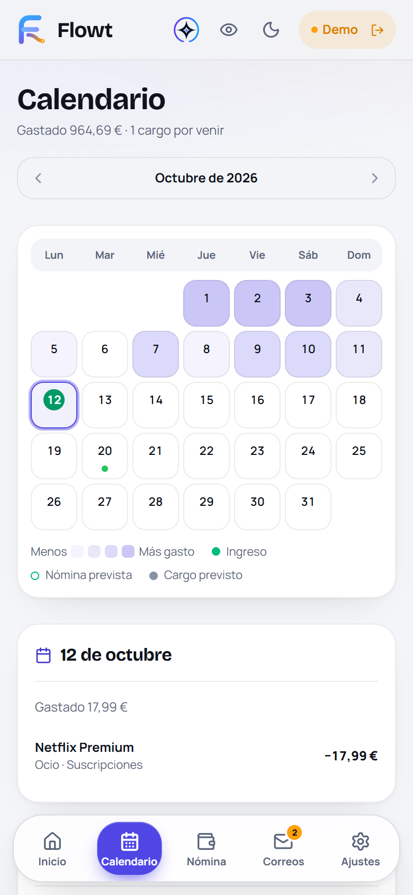
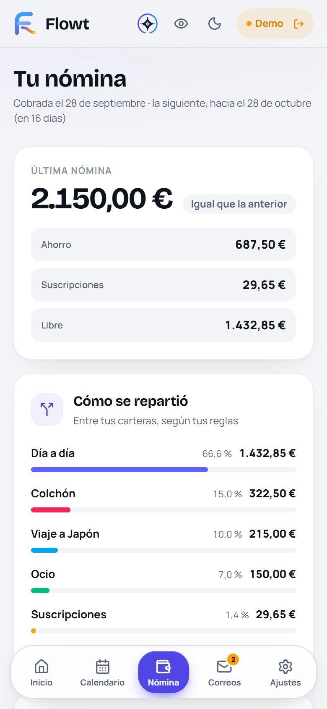

# Flowt

[English](README.md) · [Español](README.es.md)

Flowt organiza tu dinero sin pedirte trabajo extra. Lee los avisos que tu banco ya te manda a Gmail, los convierte en movimientos y te enseña cómo estás: qué tienes, a dónde se va y qué viene después.

<picture>
  <source media="(prefers-color-scheme: dark)" srcset="docs/media/readme/inicio-dark.png">
  
</picture>

Puedes probarlo sin cuenta en [flowt-63536.web.app](https://flowt-63536.web.app): elige **Explorar en modo demo** en la pantalla de entrada.

## Qué hace

### Tu dinero, sin apuntarlo a mano

- **Sincronización automática desde Gmail.** Los correos de aviso del banco se convierten en movimientos cada 30 minutos. El catálogo incluye Revolut, Unicaja, BBVA, Santander, CaixaBank, ING, Sabadell, N26 y Trade Republic, y tú eliges cuáles usas.
- **Extracción con Gemini**, con los datos personales ocultados antes de procesar el correo. Los correos que no se leen con seguridad esperan en una cola de revisión manual en vez de inventarse.
- **Propuestas de categoría y de compensación** que confirmas con un toque, y categorías propias.
- **Posibles cargos duplicados** avisados en el propio movimiento.

### A dónde se va

- **Carteras** que reparten cada ingreso con tus reglas (un porcentaje, una cantidad fija o el resto), con objetivos y paga extra en los meses que elijas.
- **Flujo de dinero**: un diagrama desde tus ingresos hasta cada categoría y lo que queda sin gastar, que puedes compartir sin importes.
- **Gasto por categorías**, evolución mensual de ingresos y gastos, y una tarjeta para las compras pequeñas que suman.
- **Bancos**: saldo estimado de cada banco a partir de tus movimientos, anclado a un saldo que anotas tú y cuadrado con tus carteras.

<picture>
  <source media="(prefers-color-scheme: dark)" srcset="docs/media/readme/flujo-dark.png">
  
</picture>

### Qué viene

- **Proyección de saldo** de 1 a 60 meses según tu ritmo real, con una franja entre el escenario prudente y el optimista y un simulador de supuestos.
- **Calendario** con lo que gastaste cada día, los cargos que quedan por venir y tu próxima nómina prevista.
- **Suscripciones**, también compartidas, con su coste anual y su peso en tu gasto.

<picture>
  <source media="(prefers-color-scheme: dark)" srcset="docs/media/readme/calendario-dark.png">
  
</picture>

### Tu nómina

- **Pestaña de nómina**: cómo se repartió la última entre tus carteras, cuánto te queda de la parte libre hasta la siguiente y los cargos que llegan antes.
- **Inicio de periodo configurable**, para que el mes vaya de nómina a nómina si es como lo piensas.
- **El precio de un gasto en horas de trabajo.**

<picture>
  <source media="(prefers-color-scheme: dark)" srcset="docs/media/readme/nomina-dark.png">
  
</picture>

### En el móvil

Flowt es una aplicación web adaptada a cualquier pantalla, con tema claro y oscuro.

<p align="center">
  <picture>
    <source media="(prefers-color-scheme: dark)" srcset="docs/media/readme/movil-inicio-dark.png">
    
  </picture>
  <picture>
    <source media="(prefers-color-scheme: dark)" srcset="docs/media/readme/movil-calendario-dark.png">
    
  </picture>
  <picture>
    <source media="(prefers-color-scheme: dark)" srcset="docs/media/readme/movil-nomina-dark.png">
    
  </picture>
</p>

### Privacidad y seguridad

- **La aplicación siempre se abre bloqueada.** Los importes quedan ocultos hasta que desbloqueas con tu PIN, tu huella o el bloqueo del dispositivo.
- **Reglas estrictas de Firestore** que aíslan los datos de cada usuario; el contenido de los correos se guarda 90 días como máximo.
- **Exportación CSV segura**, protegida contra inyección de fórmulas, y búsqueda en todo tu historial.
- **Cabeceras CSP y HSTS** en la aplicación publicada.

### Asistentes

Un **conector MCP** opcional permite que un asistente como Claude o ChatGPT consulte tus finanzas y revise movimientos, con autorización OAuth 2.1. Está apagado mientras no conectes ninguno.

## Arquitectura

```text
Gmail → Sincronizador Python → Gemini → Firestore ⇄ Aplicación web React
                                            ⇅
                              Conector MCP y API de revisiones
```

- **`src/`**: la aplicación web (React, TypeScript, Vite, Tailwind).
- **`tracker-backend/`**: el sincronizador Python que lee Gmail, extrae los movimientos con Gemini y los escribe en Firestore.
- **`mcp-worker/`**: el conector MCP y la API de revisiones como Cloudflare Worker. `tracker-backend/mcp_server.py` es una implementación equivalente en Flask para uso local o Cloud Run.
- **`firestore.rules`**, **`firestore.indexes.json`**: reglas de acceso a los datos e índices.

Consulta la [guía de arquitectura](docs/ARCHITECTURE.md) para ver los límites de cada componente y los flujos de datos.

## Requisitos

- Node.js y npm.
- Python 3.10 o posterior.
- Un proyecto de Firebase con Authentication y Firestore.
- Credenciales OAuth de escritorio de la API de Gmail con el alcance `gmail.modify`.
- Una cuenta de servicio de Firebase (`serviceAccountKey.json`) y una clave de la API de Gemini (`GEMINI_API_KEY`).

## Desarrollo local

```bash
npm install
npm run dev
```

Copia `.env.example` a `.env` en la raíz del repositorio y rellena la configuración web de Firebase:

```dotenv
VITE_FIREBASE_API_KEY=...
VITE_FIREBASE_AUTH_DOMAIN=...
VITE_FIREBASE_PROJECT_ID=...
VITE_FIREBASE_STORAGE_BUCKET=...
VITE_FIREBASE_MESSAGING_SENDER_ID=...
VITE_FIREBASE_APP_ID=...
# Opcional: URL de la API de revisiones y del conector MCP
VITE_REVIEW_API_URL=
```

El modo demo funciona sin banco ni cuenta de Gmail, así que es la forma más rápida de ver la aplicación con datos.

Para el sincronizador, consulta la [guía del backend](tracker-backend/README.md):

```bash
cd tracker-backend
python -m venv .venv
source .venv/bin/activate
python -m pip install -r requirements.txt
cp .env.example .env
python main.py
```

## Scripts

| Comando | Descripción |
|---|---|
| `npm run dev` | Arranca Vite en modo desarrollo |
| `npm run build` | Comprueba los tipos y compila la aplicación |
| `npm run lint` | Ejecuta ESLint |
| `npm test` | Ejecuta las pruebas de Vitest |
| `npm run test:rules` | Ejecuta las pruebas de las reglas de Firestore contra el emulador |
| `npm run preview` | Sirve en local la versión compilada |

Las pruebas del backend se ejecutan con `python -m pytest tracker-backend`.

## Despliegue

- **Aplicación web**: cada push a `main` compila y publica en Firebase Hosting mediante GitHub Actions.
- **Sincronizador**: un workflow de GitHub Actions lo ejecuta cada 30 minutos.
- **Reglas e índices de Firestore**: se publican a mano; hazlo antes de cualquier cambio de la web que los necesite.
- **Conector MCP**: se despliega en Cloudflare Workers con Wrangler.

Consulta la [guía de despliegue](docs/DEPLOYMENT.md).

## Documentación

- [Arquitectura](docs/ARCHITECTURE.md)
- [Despliegue](docs/DEPLOYMENT.md)
- [Backend](tracker-backend/README.md)
- [Categorías de movimientos](docs/CATEGORIES.md)
- [Propuestas de categorías y compensaciones](docs/movement-suggestions.md)
- [Revisión automática: ejecución y activación](docs/mcp-daily-review-operation.md)
- [Contribuir](CONTRIBUTING.md)
- [Política de seguridad](SECURITY.md)
- [Soporte](SUPPORT.md)

## Licencia

Flowt se distribuye bajo la [licencia MIT](LICENSE). Copyright (c) 2026 Isalvan.
